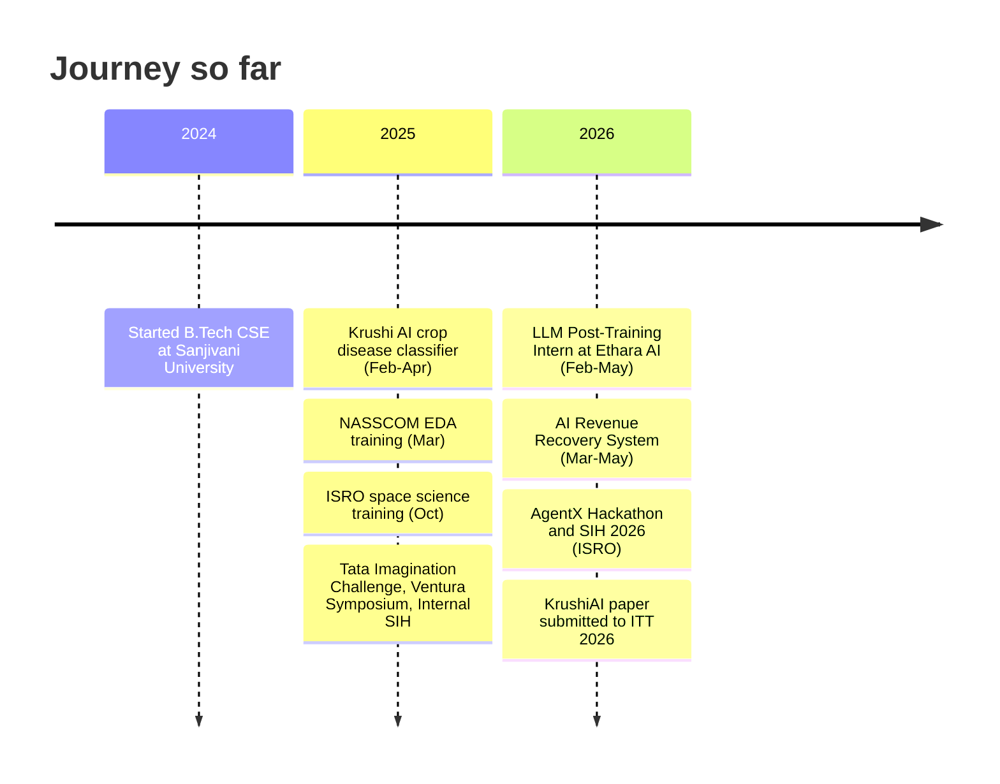

 

---

## 👋 About Me

I'm a third-year **B.Tech Computer Science** student at **Sanjivani University, Kopargaon** (2024-2028, CGPA 8.30/10). I build AI systems with **LLMs, multi-agent workflows and computer vision**, backed by strong Python and C++ and a solid base in data structures, OOP and DBMS.

- 🎯 **Looking for:** a Software Development Internship
- 🧠 **Experience:** LLM Post-Training Intern at Ethara AI (Feb-May 2026)
- 🏆 **Competed in:** 5 national hackathons and competitions, including SIH 2026 (ISRO)
- 📄 **Research:** second-author paper on pomegranate disease detection, submitted to ITT 2026
- 🗣️ **Languages:** English (proficient), Hindi and Marathi (native), Japanese (intermediate)
- 📍 **Based in:** Yeola, Maharashtra, India

---

## 🛠️ Tech Stack

**Languages**

**AI / ML**

`Machine Learning` `Deep Learning` `Computer Vision` `CNN` `Transfer Learning (MobileNetV2)` `Model Evaluation`

**LLMs and Agentic AI**

`LLMs` `Generative AI` `Prompt Engineering` `Multi-Agent Systems`

**Backend and Databases**

`REST APIs` `SSE`

**Frontend**

**Cloud and Tools**

**Core CS:** `Data Structures and Algorithms` `OOP` `DBMS` `Operating Systems` `Computer Networks`

---

## 🚀 Featured Projects

> Click a project to expand it.

<b>🛰️ SatQuery AI</b> — agentic vision-language remote-sensing assistant · <i>SIH 2026, ISRO</i>

 

**Problem:** Analysing optical, SAR and bi-temporal satellite imagery usually needs specialist tools. SatQuery AI lets users do it in natural language.

**What it does:**
- Visual question answering, captioning, change detection and Optical+SAR fusion
- Evidence generation, confidence scoring and auditable execution traces
- Trained on CDVQA/SECOND, reaching up to **92% accuracy** on benchmark evaluation

**Tech:**     

🔗 [Repository](https://github.com/Akashpingale/SATQUERY_AI) · [Live demo](REPLACE_LIVE_DEMO_URL)

<b>🤖 InsightPulse</b> — autonomous research and competitive intelligence AI agent · <i>AgentX Hackathon 2026</i>

 

**Problem:** Competitor research is slow and manual. InsightPulse plans, researches and reports on its own.

**What it does:**
- Multi-agent system with dynamic planning, tools, memory, parallel execution and failure recovery
- Evaluation and observability across accuracy, groundedness, hallucination and reliability, with tracing and root-cause diagnosis
- Real-time execution over SSE and downloadable reports, deployed on Vercel and Render

**Tech:**      

🔗 [Repository](https://github.com/Akashpingale/REPLACE_REPO_NAME) · [Live demo](REPLACE_LIVE_DEMO_URL)

<b>💸 AI Revenue Recovery System</b> — detect at-risk revenue and recover failed payments · <i>Mar-May 2026</i>

 

**Problem:** Failed payments silently cost businesses revenue. This system finds at-risk revenue, diagnoses why a payment failed and picks a recovery action.

**What it does:**
- Policy-based, bounded recovery workflows with graph-based customer intelligence
- PostgreSQL row-level security, audit trails and safety controls
- Full-stack monitoring and recovery platform, Dockerized

**Tech:**     

🔗 [Repository](https://github.com/Akashpingale/REPLACE_REPO_NAME) · [Live demo](REPLACE_LIVE_DEMO_URL)

<b>🌱 Krushi AI</b> — crop and pomegranate disease detection · <i>Feb-Apr 2025, plus research paper</i>

 

**Problem:** Early detection of crop diseases from leaf and fruit images.

**Results:**
- CNN multi-class crop disease classifier: **92% accuracy** on the Plant Village dataset
- Follow-up MobileNetV2 pomegranate disease model (reported in our paper): **93.92% validation accuracy**, **0.9325 macro F1**, **9.59 MB** model size

**Paper:** *A Deep Learning Approach for Early Detection and Classification of Pomegranate Fruit Diseases Using Convolutional Neural Networks* — second author, supervised by Prof. Patolla Venkat Reddy. Submitted to ITT 2026, 11th International Conference.

**Tech:**   `CNN` `MobileNetV2`

🔗 [Repository](https://github.com/Akashpingale/REPLACE_REPO_NAME)

---

## 💼 Experience

<b>LLM Post-Training Intern</b> — Ethara AI (Virtual) · <i>Feb 2026 - May 2026</i>

 

- Performed model evaluation and data preprocessing on LLM outputs, using prompt engineering that improved response quality by **95%**
- Contributed to the model post-training lifecycle: iterative fine-tuning and deployment readiness checks

<b>Virtual Intern</b> — Infosys Springboard Virtual Internship 7.0 (Batch 4) · <i>In progress</i>

 

- 8-week programme, currently in progress

---

## 🏆 Hackathons, Competitions and Achievements

| | |
|---|---|
| 🛰️ **SIH 2026 (ISRO)** | SatQuery AI |
| 🤖 **AgentX Hackathon 2026** | InsightPulse |
| 🎖️ **Tata Imagination Challenge 2025** | Participant |
| 🎖️ **Ventura Symposium 2025** | Participant |
| 🎖️ **Internal SIH 2025** | Participant |

- 🎤 College Ambassador: public speaking and community outreach

---

## 📜 Certifications and Training

<b>Click to expand (8)</b>

 

- NPTEL: Joy of Computing using Python (**With Distinction**)
- Infosys Springboard: Deep Learning for Developers
- Infosys Springboard: Generative Models for Developers
- Infosys Springboard: Principles of Generative AI Certification
- Infosys Springboard: Agile Scrum in Practice
- MongoDB: Introduction to MongoDB (For Students)
- NASSCOM: Exploratory Data Analysis (Mar 2025)
- ISRO: Space Science and Technology Awareness Training (Oct 2025)

---

## 🧭 My Journey

---

## 📊 GitHub Stats

  
  

  

  

---

## 📫 Let's Connect

I'm looking for a **Software Development Internship** where I can build AI-powered products.

*Build things that work, then measure them honestly.*

## 🐍 GitHub Contribution Snake

